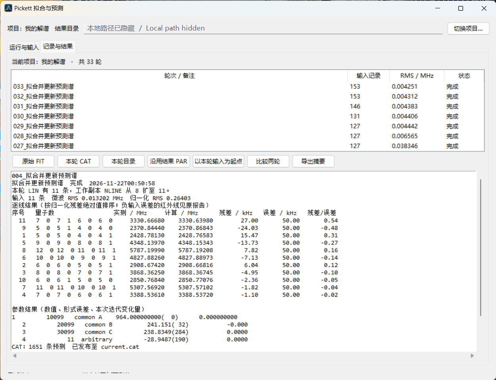
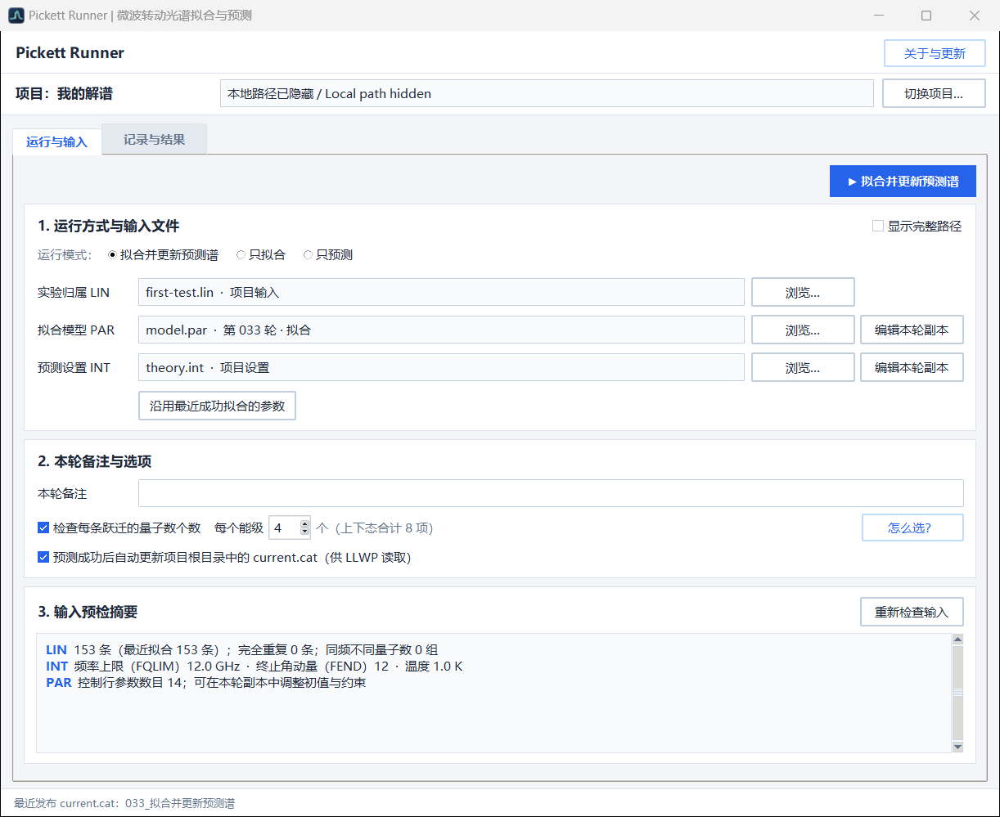

<div align="center">

# Pickett Runner

**One-click fitting and prediction for microwave rotational spectroscopy**

Windows desktop interface | SPFIT + SPCAT | Python · Tkinter

[简体中文](README.md) · English

</div>

Developed by [qiransy](https://github.com/qiransy), Pickett Runner simplifies the iterative assignment workflow in rotational spectroscopy. Select assigned transitions and model files, run SPFIT, and automatically launch SPCAT to produce an updated catalog for the next assignment round in LLWP.

## Real-world example

The screenshots show an actual assignment of the two-state tunneling system Homo-3. After 33 fitting rounds, the final fit contains 153 assigned transitions and has a microwave RMS of **4.251 kHz**.

<div align="center">
  
  <br>
  <sub>Run history and results. The list shows recent fitting rounds, while the detailed report below displays round 004.</sub>
</div>

## Key features

| Feature | Role in the assignment workflow |
| --- | --- |
| **One-click fitting and prediction** | Run SPFIT and SPCAT in sequence, or run either program independently. |
| **Model and line-list management** | Select LIN, PAR, INT and VAR files independently and edit working parameter copies. |
| **Project-specific run history** | Archive inputs, original FIT reports, VAR and CAT files for inspection and comparison. |
| **Fit diagnostics** | Inspect RMS, line-by-line residuals, fitted parameters and formal uncertainties. |
| **Updated prediction catalog** | Refresh current.cat after a successful prediction for the next LLWP assignment round. |

## Getting started

`Experimental spectrum + initial prediction → LLWP assignment → LIN → SPFIT fit → SPCAT prediction → current.cat → next assignment round`

<div align="center">
  
  <br>
  <sub>Input configuration. Select the assigned line list, fitting model and prediction settings to start a new run.</sub>
</div>

1. Install Python 3.10 or later with Tkinter on Windows.
2. Download this repository and place separately obtained spfit.exe and spcat.exe in the pickett-runner directory.
3. Launch the script from that directory.

```shell
python pickett_runner.py
```

4. Select a project directory and the LIN, PAR and INT files, then choose the combined fit-and-predict mode.
5. Inspect the results and load the updated current.cat in LLWP.

See the [Pickett Runner user guide](pickett-runner/README.en.md) for details, or view the [source code](pickett-runner/pickett_runner.py).

## AI Research Workflow Skill (Agent Skill)

This repository also includes an open-format AI agent domain skill, [`microwave-spectroscopy-workflow`](skills/microwave-spectroscopy-workflow/SKILL.md), designed to support:

- Literature search and [Zotero tagging](skills/microwave-spectroscopy-workflow/references/zotero-profile.md) for gas-phase rotational spectroscopy, molecular clusters, and microsolvation;
- Organizing CREST / Gaussian / ORCA conformer calculations while preserving original identifiers and energy conventions;
- Comparing calculated rotational constants, dipole components, and nuclear quadrupole tensors against SPFIT / SPCAT (Pickett Runner) fits;
- Progress reports, assignment evidence audits, and manuscript/figure presentation.

### Codex (project installation)

1. Download and extract this repository, or clone it with Git.
2. Copy the entire `skills/microwave-spectroscopy-workflow/` folder, including `references/`, into your project’s `.agents/skills/` directory. The resulting entry point is `<project>/.agents/skills/microwave-spectroscopy-workflow/SKILL.md`.
3. Open that project in Codex and start a new chat. Select `microwave-spectroscopy-workflow` from the skill picker. In the Codex CLI, use `/skills` to list skills.

For a first task, ask the skill to check the rotational-constant units, conformer identifiers, and energy conventions in a calculation summary. Running SPFIT/SPCAT requires the executables described above.

### Antigravity (plugin)

```shell
git clone https://github.com/qiransy/microwave-spectroscopy-toolkit.git ~/.gemini/config/plugins/microwave-spectroscopy-toolkit
```

See the [skill guide](skills/microwave-spectroscopy-workflow/README.md#codex) for copy commands and verification. For general chemistry and materials writing/plotting skills, pair it with [chem-materials-research-kit](https://github.com/qiransy/chem-materials-research-kit).

## About this repository

Pickett Runner is the central project of this repository. Additional material on microwave rotational spectroscopy, assignment practice and the theoretical background will accompany the software as supporting resources.

Maintained by [qiransy](https://github.com/qiransy).

SPFIT and SPCAT were developed by H. M. Pickett. This repository provides a graphical companion tool. The original programs must be obtained separately. See the [user guide](pickett-runner/README.en.md#reference) for the publication reference.
