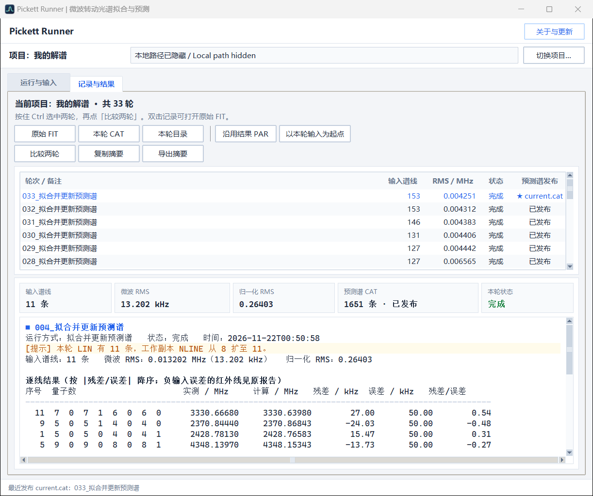
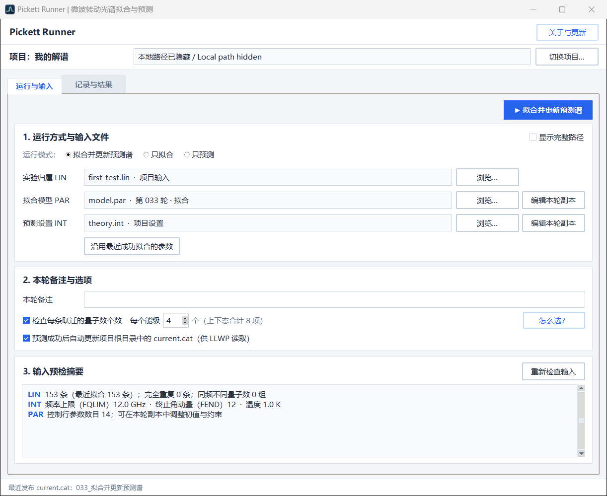

<div align="center">


# Pickett Runner

**微波转动光谱 · 迭代拟合、预测与留痕工具**

Windows 桌面端｜SPFIT + SPCAT｜Python 标准库 · Tkinter（零第三方依赖）

简体中文 · [English](README.en.md)

</div>

**Pickett Runner** 是 [`microwave-spectroscopy-toolkit`](https://github.com/qiransy/microwave-spectroscopy-toolkit) 仓库的核心工具，由 [qiransy](https://github.com/qiransy) 维护，面向气相微波转动光谱的日常迭代解谱工作。你可以在同一窗口中管理实验归属线表与哈密顿量模型，一键串联 **SPFIT 拟合**与 **SPCAT 预测**，自动留存每轮输入快照与拟合报告，并将更新后的 `current.cat` 交回 LLWP 进行下一轮谱线归属。

仓库同时内置面向气相微波光谱研究的 AI Agent 领域技能 [`microwave-spectroscopy-workflow`](skills/microwave-spectroscopy-workflow/SKILL.md)，用于辅助文献管理、构象计算整理与拟合结果核对。

## 实战展示

下面的界面来自 Homo-3 两态隧穿体系的实际解谱过程。经过 33 轮迭代，最终拟合 153 条归属谱线，微波 RMS 为 **4.251 kHz**。

<div align="center">
  
  <br>
  <sub>记录与结果界面。上方列表展示拟合轮次与发布标记，下方给出关键指标条及按归一化残差排序的逐线拟合报告。</sub>
</div>

## 核心功能

| 功能 | 解谱中的用途 |
| --- | --- |
| **三模式运行与安全发布** | 支持「拟合并更新预测谱」「只拟合」「只预测」三种模式，分别定位 `spfit.exe` 与 `spcat.exe`。联合模式直接传递当轮拟合生成的 `VAR`；若预测失败，自动保留上一份成功发布的 `current.cat`。 |
| **工作副本编辑与输入预检** | 独立选择 `LIN`、`PAR`、`INT`、`VAR`。内置副本编辑器可调整 PAR 参数约束、新增参数或修改 INT 频率上限、角动量上限与温度，不改写原始文件；运行前自动检查线数增删、重复记录、量子数个数及 `NLINE` 容量。 |
| **项目隔离与全过程留痕** | 按项目目录自动编号归档每轮输入快照、原始 `FIT`、`VAR`、`CAT` 与运行日志，支持沿用同轮 `PAR`/`VAR` 或以任意历史轮次输入为起点继续迭代。 |
| **结果诊断与两轮对比** | 顶部指标条集中展示谱线数、微波 RMS（自动换算 kHz）、归一化 RMS 与 CAT 条数；逐线残差与拟合警告自动高亮；支持按住 `Ctrl` 选中两轮对比 RMS 与输入文件差异，并一键复制或导出摘要。 |
| **高分屏友好与在线信息** | 仅依赖 Python 标准库，适配 Windows 高分屏与 125% 显示缩放；内置「关于与更新」入口，可直达仓库文档、Issues 并按需检查 GitHub 最新版本（断网不影响本地离线解谱）。 |

## 如何使用

```text
实验谱 + 初始预测 → LLWP 归属 → LIN → SPFIT 拟合 → SPCAT 预测 → current.cat → 继续归属
```

谱线归属配合 **LLWP** 使用。安装、导入实验谱与 `CAT` 文件、导出 `LIN` 线表可参照 [LLWP 官方使用指南](https://llwp.astro.uni-koeln.de/docs.html)，软件论文见 [Bonah 等，2022](https://doi.org/10.1016/j.jms.2022.111674)。

<div align="center">
  
  <br>
  <sub>运行与输入界面。分块展示输入文件、本轮备注校验与实时预检摘要，右上角一键启动计算。</sub>
</div>

1. 在 Windows 安装包含 Tkinter 的 Python 3.10 或更高版本（无需额外 `pip install` 第三方库）。
2. 下载或克隆本仓库，将从合法来源获取的 `spfit.exe` 与 `spcat.exe` 放在 `pickett-runner/` 目录（源码运行时也支持放在上一级或上两级目录）。
3. 双击脚本或在目录内运行：

```shell
python pickett_runner.py
```

4. 在窗口中选择项目目录与 `LIN`、`PAR`、`INT` 文件，确认预检信息后点击右上角运行按钮。
5. 在「记录与结果」页核对 RMS、逐线残差与拟合参数，随后在 LLWP 中加载更新后的 `current.cat`。

详细操作、文件归档结构与参考文献见 [Pickett Runner 使用说明](pickett-runner/README.md)，也可以直接阅读 [源代码](pickett-runner/pickett_runner.py)。

## AI 科研工作流技能（Agent Skill）

本仓库同时内置面向气相微波转动光谱的开放 AI Agent 领域技能 [`microwave-spectroscopy-workflow`](skills/microwave-spectroscopy-workflow/SKILL.md)，用于规范化辅助：

- 气相转动光谱、团簇与微溶剂化的文献调研与 [Zotero 标签管理](skills/microwave-spectroscopy-workflow/references/zotero-profile.md)；
- CREST / Gaussian / ORCA 构象计算结果整理（保留原始编号与能量口径，不替研究者擅自筛选候选）；
- 理论转动常数、偶极矩、核四极张量与 SPFIT / SPCAT（Pickett Runner）拟合结果的规范对照；
- 组会进展报告、论文指认证据边界审查与图表专业表达。

### Codex（项目级安装）

1. 下载并解压本仓库，或用 Git 克隆。
2. 将完整的 `skills/microwave-spectroscopy-workflow/` 文件夹复制到课题目录的 `.agents/skills/`，保留其中的 `references/`。最终入口为 `<课题目录>/.agents/skills/microwave-spectroscopy-workflow/SKILL.md`。
3. 在 Codex 中打开该课题目录并开启新对话，从 Skill 选择器选用 `microwave-spectroscopy-workflow`（CLI 中可用 `/skills` 查看）。

可以先请 Codex 用该技能核对一份计算结果的转动常数单位、构象编号和能量口径。运行 SPFIT / SPCAT 仍需按上方说明单独准备程序。

### Antigravity（插件）

```shell
git clone https://github.com/qiransy/microwave-spectroscopy-toolkit.git ~/.gemini/config/plugins/microwave-spectroscopy-toolkit
```

复制命令与验证步骤见 [技能使用说明](skills/microwave-spectroscopy-workflow/README.md#codex)。如需搭配通用化学/材料论文读写与绘图技能，可配合使用 [chem-materials-research-kit](https://github.com/qiransy/chem-materials-research-kit)。

## 关于本仓库

本仓库以 **Pickett Runner** 与微波转动光谱研究工作流为核心，后续会逐步补充与解谱实践、理论背景相关的资料。

- 维护者：[qiransy](https://github.com/qiransy)
- 第三方程序说明：SPFIT 和 SPCAT 由 H. M. Pickett 开发。本仓库仅提供图形化辅助工具源代码与相关文档，原程序需独立获取；相关文献见 [使用说明](pickett-runner/README.md#参考文献)。
