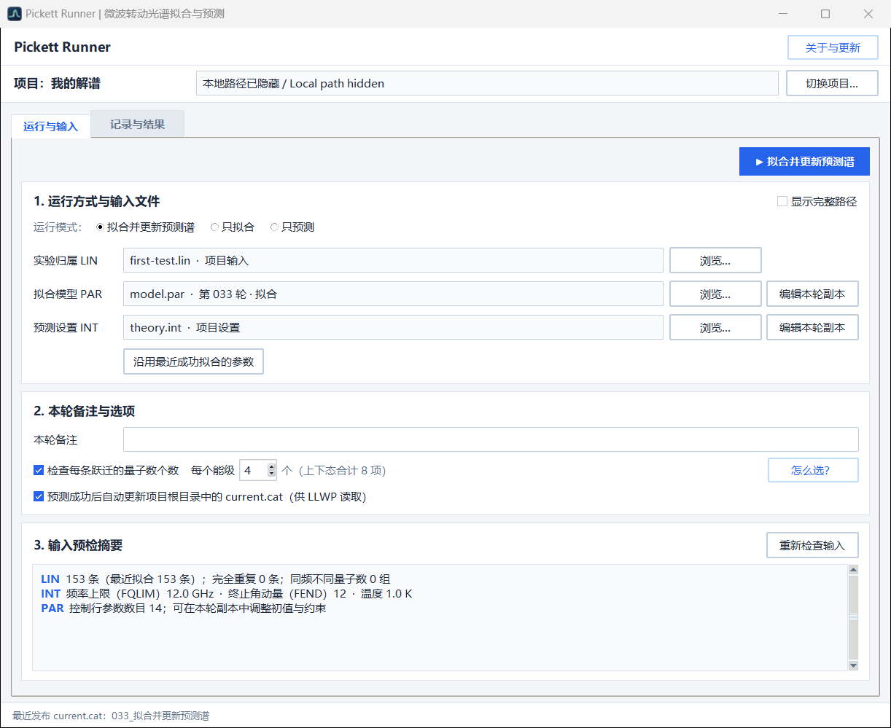
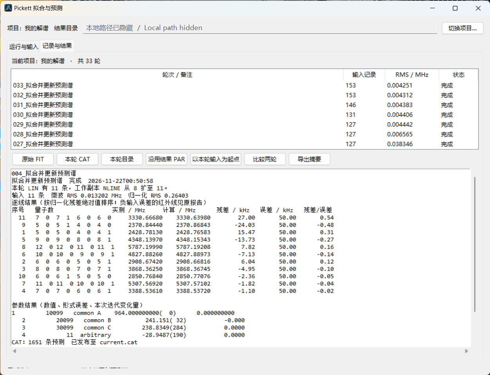

# Pickett Runner User Guide

[Repository home](../README.en.md) · [简体中文](README.md) · English

Pickett Runner is a lightweight Windows desktop interface for Pickett's SPFIT and SPCAT programs, built with the Python standard library and Tkinter. The application interface is currently in Simplified Chinese and can be used alongside line-assignment tools such as LLWP.

## Run modes

| Mode | Required inputs | Purpose |
| --- | --- | --- |
| Fit and update prediction (拟合并更新预测谱) | LIN, PAR, INT | Run SPFIT and then SPCAT to generate an updated CAT file. |
| Fit only (只拟合) | LIN, PAR | Obtain a fit report and updated model parameters. |
| Predict only (只预测) | VAR, INT | Calculate predictions from existing model parameters. |

## Installation and quick start

1. Install Python 3.10 or later with Tkinter on Windows.
2. Obtain SPFIT and SPCAT separately from their legitimate distribution source. Place spfit.exe and spcat.exe in this directory (the parent directory is also supported).
3. Launch the application.

```shell
python pickett_runner.py
```

Alternatively, use pythonw.exe to launch without a console window.

4. Select an existing project directory and the LIN, PAR, INT or VAR files required by the chosen mode.
5. Review line counts, duplicate entries and any optional quantum-number checks. Edit working copies of PAR or INT if needed.
6. Click Run (运行). On completion, open Run History and Results (记录与结果) to inspect RMS, individual residuals and fitted parameters.
7. If automatic publication is enabled, load the updated current.cat in LLWP for the next assignment round.

## Screenshots

The example below shows actual iterative assignments for the two-state tunneling system Homo-3.

### Run and input settings



The current project contains 153 line records and a 14-parameter model, with four quantum-number labels per energy level.

### Run history and results



The history contains 33 fitting rounds, with a final microwave RMS of 4.251 kHz. The detailed report displayed is from round 004 and shows observed and calculated frequencies, residuals, fitted parameters and the number of predicted catalog lines.

## Files and projects

- Each project keeps input snapshots, fitting output, prediction files and logs in its own run-history directory (运行记录).
- PAR and INT edits are applied to working copies while the original input files are preserved.
- The history allows reuse of the most recent successful PAR, restarting from a selected round's inputs, and comparison of two fitting rounds.
- Quantum-number count checking is optional. Exact duplicate entries are flagged for review.
- current.cat is updated only after successful prediction when publication is enabled.

## Third-party programs

SPFIT and SPCAT were developed by H. M. Pickett. This repository contains the graphical companion tool, source code and icon. Obtain the original executables separately. Consult the original program documentation for parameter codes and Hamiltonian definitions.

## Reference

H. M. Pickett, *The fitting and prediction of vibration-rotation spectra with spin interactions*, Journal of Molecular Spectroscopy **148**, 371–377 (1991).

Maintained by [qiransy](https://github.com/qiransy).
