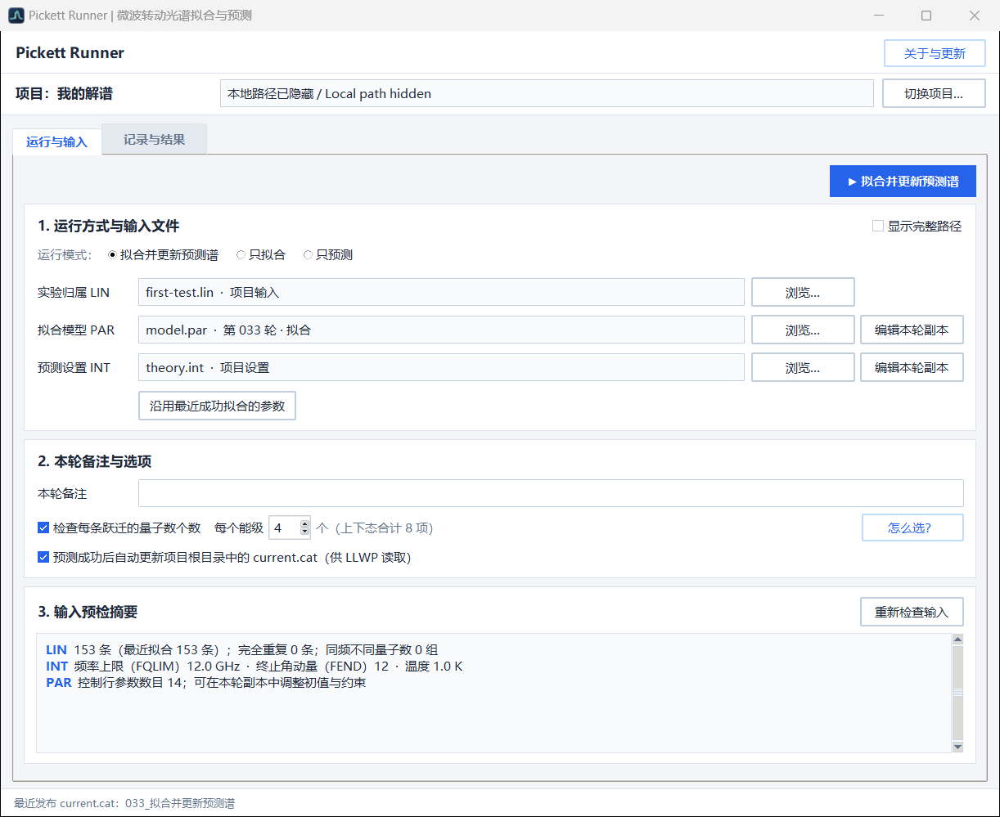
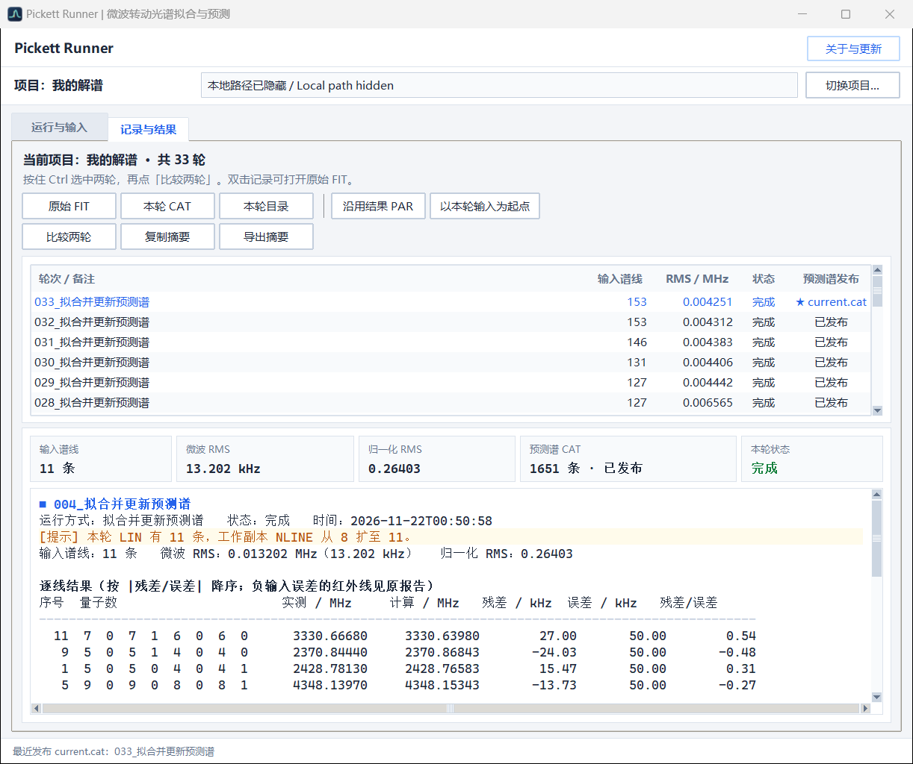

<div align="center">


# Pickett Runner 使用说明

[仓库首页](../README.md) · 简体中文 · [English](README.en.md)

</div>

Pickett Runner 是用于 Pickett SPFIT 和 SPCAT 的 Windows 图形化辅助工具，使用 Python 标准库 Tkinter 开发（零第三方依赖），适配高分屏与 125% 显示缩放。当前软件界面为简体中文，适合与 LLWP 等谱线归属工具配合。

## 运行方式

| 模式 | 输入文件 | 输出与用途 |
| --- | --- | --- |
| 拟合并更新预测谱 | LIN、PAR、INT | SPFIT 拟合后使用当轮生成的 VAR 立即调用 SPCAT，得到新的 CAT；预测失败时保留上一份成功发布的 `current.cat`。 |
| 只拟合 | LIN、PAR | 查看拟合报告和更新后的模型参数。 |
| 只预测 | VAR、INT | 根据现有参数计算预测线表。 |

## 安装与快速上手

1. 安装 Windows 版 Python 3.10 或更高版本，并确保安装 Tkinter。
2. 从原程序的合法来源获取 SPFIT 和 SPCAT，将 `spfit.exe`、`spcat.exe` 放到本目录（源码运行时也支持放在上一级或上两级目录，并分别定位）。
3. 运行以下命令打开软件：

```shell
python pickett_runner.py
```

也可以使用 `pythonw.exe` 启动脚本，以免显示命令行窗口。

4. 在顶部项目栏选择一个已有的项目目录，按照运行模式指定 `LIN`、`PAR`、`INT` 或 `VAR`。
5. 在下方「输入预检摘要」中核对线数增删、重复记录、量子数检查与 `NLINE` 容量；如需微调，可点击「编辑本轮副本」修改 PAR 约束/新增参数或调整 INT 频率上限（FQLIM）、角动量上限（FEND）与温度（TEMP）。
6. 点击右上角运行按钮。完成后自动切换至「记录与结果」，查看顶部指标条、逐线残差与参数结果。
7. 若启用了「预测成功后自动更新项目根目录中的 current.cat」，将新的 CAT 加载至 LLWP 进行下一批谱线归属。

LLWP 的安装、谱图与线表导入、归属及保存见 [LLWP 官方使用指南](https://llwp.astro.uni-koeln.de/docs.html)。

## 界面示例

以下为 Homo-3 两个隧穿态的实际解谱记录。

### 运行与输入



当前项目的线表含有 153 条记录，模型含有 14 个参数，每个能级使用 4 个量子数标签。运行按钮固定在右上角，底部「输入预检摘要」实时展示各输入文件状态。

### 记录与结果



共 33 轮拟合，最后一轮的微波 RMS 为 4.251 kHz，并标出当前发布的 `★ current.cat`。下方指标条与逐线报告展示第 004 轮的实测频率、计算频率、残差及 CAT 条数；支持双击列表打开原始 `FIT`，以及按住 `Ctrl` 选中两轮比较差异、一键复制或导出摘要。

## 文件与项目管理

- 每个项目在自己的「运行记录」目录保存输入快照、拟合文件、预测文件和运行日志。
- 编辑 PAR、INT 时采用本轮工作副本，原始输入文件保留，未运行的编辑草稿和备注支持跨会话保存。
- 在历史记录中可沿用同轮成功拟合的 PAR 与 VAR、以指定轮次的输入为起点，或按住 `Ctrl` 选两轮比较 RMS 和输入差异，并复制或导出比较报告。
- 检查每态量子数个数是可选的；完全重复记录会提示，同频不同量子数记录可用于进一步核对。
- 只有预测成功并勾选更新选项时才会原子覆盖 `current.cat`，预测失败时保留上一份成功发布的版本。
- 顶栏右侧提供「关于与更新」，可快速打开 GitHub 仓库、在线说明与 Issues，并按需在后台检查最新版本（离线环境不影响正常解谱）。

## 第三方程序

SPFIT 和 SPCAT 由 H. M. Pickett 开发。本仓库包含辅助界面源代码及图标等材料，SPFIT 与 SPCAT 可执行文件需独立获取。参数编码和具体哈密顿量定义请参照原程序文档。

## 参考文献

H. M. Pickett, *The fitting and prediction of vibration-rotation spectra with spin interactions*, Journal of Molecular Spectroscopy **148**, 371–377 (1991).

L. Bonah, O. Zingsheim, H. S. P. Müller, J.-C. Guillemin, F. Lewen, S. Schlemmer, [*LLWP—A new Loomis-Wood software at the example of Acetone-13C1*](https://doi.org/10.1016/j.jms.2022.111674), Journal of Molecular Spectroscopy **388**, 111674 (2022).

维护者：[qiransy](https://github.com/qiransy)
